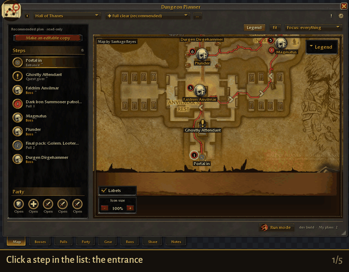
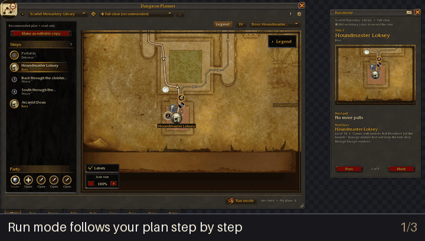
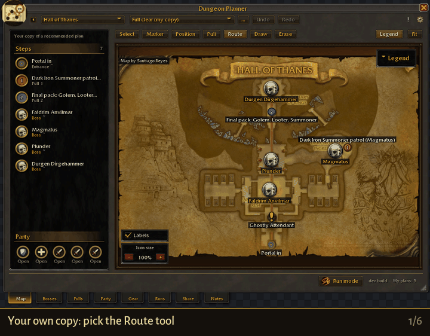
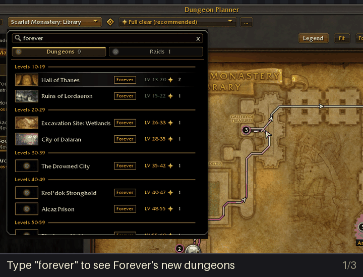

# Dungeon Planner

Plan dungeon and raid runs in **World of Warcraft: Forever**: mark bosses, packs and points of interest on the game's
own maps, group them into pulls, draw routes, write boss strategies by phase, assign players, list gear, track boss
kills and objectives, get ready and find the way to the entrance, follow the plan with your group, and share plans in
game, as text, or on Discord.

> Status: **beta** (0.2.1), not yet tested broadly in game. Everything below is implemented and covered by offline
> tests; expect rough edges in the client and please report them (`/dp report`); see [What is verified](#what-is-verified)
> and the release notes of [0.2.1](docs/RELEASE-NOTES-0.2.1.md) and [0.2.0](docs/RELEASE-NOTES-0.2.0.md) (what's new,
> upgrade notes, known limitations on Forever, the test checklists).

## See it

Short clips of the main interactions, rendered offline from the addon's own UI code with the game's textures, so
details differ a little from the client. In-game screenshots are in [docs/screenshots/](docs/screenshots/). The images
contain Blizzard Entertainment game art, are not under the MIT licence and are shown for documentation only
([docs/media/README.md](docs/media/README.md)).

| Click a step, the map follows | Run mode: Next, Next |
|---|---|
|  |  |
| **Draw a route** on your own copy | **Find an instance** by name, level or "forever" |
|  |  |

## Features

Dungeon Planner works on its own: maps, boss portraits, abilities, loot, levels and dungeon quests are built in. Other
addons add extras when installed (see "Recommended companion addons").

- **A war table**: the map fills the window; the plan's steps (entrance, packs, bosses, objectives) and the party sit
  beside it, and clicking a step shows it on the map. Pick the instance and the plan from the header.
- **Run mode**: a small window to keep open while playing: the current step, the next pull, tips for the next boss and
  a mini map, with Prev / Next (also on the pull key bindings) and automatic progress when a boss dies. With the run
  recorder on, it shows your progress against the plan and warns when you take more pulls than planned before a boss
  or kill bosses out of order. In a group, the leader can lead the run: members with the same plan follow the
  leader's step, can step on their own and rejoin, and a member without the plan asks for it in one click.
- **Prep**: the instance's quests and where they stand in your log, the keys and attunements it needs and whether you
  have them, your group's levels against the level range and the roles still missing, and your own prep notes.
- **Getting there**: the entrance's zone, area and coordinates, the nearest flight master and the way from it, boats,
  zeppelins and summoning stones, and outdoors a live map with your position and direction. "Navigate" hands the
  entrance to Polestar, Shortest Path Forever or TomTom, else to the game's map pin; walking in with the window open
  opens the plan and run mode. Entrances you use are learned. "Show location" in the header pins the entrance.
- **Run recorder** (opt-in): pulls, boss kills and wipes of your runs; a run against the plan (extra and skipped pulls,
  boss order), two runs side by side, splits against your best and previous run, a run summary for Discord.
- **Map planning** on the game's own dungeon maps (the old dungeon map tiles the client still has; every floor, with a
  floor switcher in the map's corner; for
  Forever's new dungeons the hand-drawn maps by Santiago Reyes that come with the addon, used with his permission;
  the game's own minimap pictures, composed per floor in the same parchment colours, if you prefer them). Markers of 17 kinds (bosses, rares, packs, patrols, loot,
  chests, quest items and givers, NPCs, objects, entrances, exits, shortcuts, stairs, hazards, party positions, notes);
  raid marks; labels and notes per marker; drag to move; zoom and pan; layers you can hide; an Enemies layer showing
  where the plans' research placed creatures. Undo and redo (50 steps) for every change.
- **Map drawing** on your own plans: pen, line, arrow, circle, box, text, eraser, eight colours and three widths;
  drawings can belong to a boss or a pull.
- **Pulls**: ordered, coloured groups of markers with notes, tags (Interrupt, Crowd control, Line of sight, Pull with
  next, Skip, Careful), planned cooldowns and Bloodlust, and the forces after each pull; a Pull tool to click packs into
  pulls.
- **Routes**: draw paths with Snap to corridors (lines follow the corridors instead of cutting through walls), build a
  route through your pulls, or let "Suggest order" find a short path. A colour that shifts along each route so you can
  tell which part comes first, direction arrows, the leg under the pointer highlighted, two lanes with the way back
  dashed where a route doubles back, and a Routes group in Settings for line and arrow styles.
- **Encounters**: every boss of the recommended plans with a portrait, level, key abilities (names and tooltips from
  the game) and loot from the addon's own boss data (or your own bosses), strategy text and phases with triggers.
- **Party**: the seats fill from the people you are grouped with (by role, or a guess from the class) until you store
  your own.
- **Assignments**: per boss and phase, for a player, a role, a raid group or everyone; raid groups 1-8; post them to
  group chat.
- **Raid pages**: free-text assignment pages per boss with keywords (`{star}`, `{tank}`, `{group 2}`, `{mage}`), names
  in class colour; a small Notes window that opens on the boss's pull; the raid leader sends pages to the group.
- **Gear**: each boss's drops, filtered by class and slot, and your own recommendations per class, role, slot and boss
  (item IDs or dragged items, names from the game).
- **Progress**: boss kills per run and lifetime (ENCOUNTER_END, BOSS_KILL, DBM/BigWigs as backup), an objective
  checklist per plan.
- **Many plans per instance** (strategies, difficulties), profiles, a colour-blind setting.
- **Sharing**: send to your group, guild or a player (accept/decline prompt, size and checksum checks); export and
  import strings; instance packs; **Discord** text split into 2000-character messages; a community plan repository;
  who in your group has the plan you sent, and whether their copy is outdated.
- **Interface in six languages**: English, German, Spanish, French, Polish and Russian (automatic: your game's language, or Polish with WoW Po Polsku; German, Spanish, French and Russian are a first pass that native speakers are invited to improve, see `Locales/README.md`), minimap button, key bindings, Addon Compartment, options in the
  game's Settings panel, a public API for other addons and WeakAuras.
- **Data from other addons** you have installed, read in your game only (nothing is copied) and switchable under
  Settings > Data from other addons; each source is named where its data shows:
  - **Dungeon Journal**: boss pins on the maps of Forever's new dungeons, boss portraits and loot per boss (Gear), and a
    button to open it;
  - **Forever Dungeon Routes**: its routes as an extra map layer (also on the bundled maps);
  - **OpenMap**: drawn dungeon maps and boss pins (and your plans on its dungeon card); experimental and off by
    default: your plan drawn on OpenMap's own dungeon map;
  - **NeedRoll**: "Open in NeedRoll" in Gear; **Questie**: the dungeon's quests in Runs, and who gives each in Prep;
  - **Polestar**, **Shortest Path Forever** or **TomTom**: "Navigate" in Getting there hands them the way to the
    entrance;
  - **DBM** or **BigWigs**: boss kills as a backup to the game's own events.

The addon's code ships **no game data**: instances, bosses and maps come from your client. The maps of Forever's new
dungeons are Santiago Reyes' artwork, bundled with his permission (credits below). It does include
**recommended plans** for 43 Classic and Forever dungeons and raids, researched by the community (boss order, routes,
pulls, strategies and party positions; positions are approximate, and each plan states its confidence). Sources and
credits: [docs/DATA-SOURCES.md](docs/DATA-SOURCES.md).

## Recommended companion addons

Dungeon Planner works on its own. If you also have these addons, it reads extra data from them in your game only
(nothing is copied; each source is named where its data shows, and each can be switched off under Settings > Data from
other addons). Settings lists the ones you do not have, with what they would add.

| Addon | What it adds to Dungeon Planner | |
|---|---|---|
| **[DungeonJournal](https://www.curseforge.com/wow/addons/dungeonjournal)** (Dungeon Journal) | **Recommended.** Boss pins on the maps of Forever's new dungeons, boss portraits, each boss's loot (Gear), its level and description, and a button on the Bosses page that opens it | Pins, portraits, loot |
| **[Forever Dungeon Routes](https://www.curseforge.com/wow/addons/forever-dungeon-routes)** | **Recommended.** Its routes as an extra map layer (off until you tick it in the legend; not shown in run mode), on the bundled maps of Forever's new dungeons too | Routes |
| [OpenMap](https://www.curseforge.com/wow/addons/openmap) | Drawn maps and boss pins as a further map source (used after the two above), your plans listed on its dungeon cards, and a Dungeon Planner switch in its menu; experimental, off by default: the plan's route, stops and markers on its own dungeon map (relies on its private view) | Maps, plans on its cards, the plan on its map |
| [NeedRoll](https://www.curseforge.com/wow/addons/needroll) | An "Open in NeedRoll" button in Gear that opens its loot page for the boss you picked | Loot |
| [QuestieDB](https://www.curseforge.com/wow/addons/questiedb) (the data part of [Questie](https://www.curseforge.com/wow/addons/questie)) | The dungeon's quests, with level and quest giver, in Runs, and who gives each quest and where in Prep | Quests |
| Polestar, Shortest Path Forever or [TomTom](https://www.curseforge.com/wow/addons/tomtom) | "Navigate" in Getting there hands the entrance to the first one installed (Polestar also estimates the travel time); without them the game's own map pin | Directions |
| [DBM](https://www.curseforge.com/wow/addons/deadly-boss-mods) or [BigWigs](https://www.curseforge.com/wow/addons/big-wigs) | A backup boss-kill signal for progress tracking when the game's own encounter events are missed | Kills |
| [WoW Po Polsku Forever](https://www.curseforge.com/wow/addons/forever-wowpopolsku-2-0) | Dungeon Planner switches to Polish automatically when you chose Polish in it, and follows its fonts | Polish UI |

Without any of them, Forever's new dungeons are drawn on Santiago Reyes' bundled maps, and boss data, portraits and
loot come from Dungeon Planner's bundled facts.

## Install

- From CurseForge (Dungeon Planner, for WoW: Forever), or
- download a release zip and extract the `DungeonPlanner` folder to `World of Warcraft\_forever_\Interface\AddOns\`.

## Use

| | |
|---|---|
| `/dp` or `/dplan` | open or close |
| `/dp map`, `/dp next`, `/dp prev` | the plan's map; next / previous pull (the next / previous step in run mode) |
| `/dp run` | open or close run mode |
| `/dp notes` | open or close the Notes window (raid pages) |
| `/dp share` | offer the selected plan to your group |
| `/dp import` | the Share page of the selected plan |
| `/dp settings`, `/dp minimap`, `/dp reset` | options; show/hide the minimap button; reset the window |
| `/dp debug` | client and API report, self-tests, Polish letter test |
| `/dp report` | report a problem: a text to paste into a GitHub issue (also the `!` button in the window's title bar); it holds no character, realm, guild or group details |
| `/dp new` | what's new in this version (shown once after an update; a welcome on a first install) |
| `/dp perf`, `/dp perf start`, `/dp perf stop` | opt-in timing of the addon's handlers and redraws, and its memory; off until started |
| `/dp scan`, `/dp scan clear` | save diagnostics (journal, Group Finder, maps, game files) for bug reports, written on `/reload`; remove them |
| `/dp mapid` | print the current map ID |
| `/dp entrances`, `/dp entrances reset` | how many instance entrances were learned from play; forget them |
| `/dp shots`, `/dp shots stop` | take a screenshot of every view of the window (Escape stops) |
| Key bindings | Options > Keybindings > AddOns > Dungeon Planner (no keys are set for you) |

1. Pick a dungeon or raid in the home table (or **Current location**) and **Open plan**. A recommended plan opens if
   one ships for it; **Make an editable copy** (side panel) to change it.
2. Or **Create a plan**, choose a template, name it.
3. Map: place markers (packs, patrols, loot, quests, doors, hazards, party positions), group packs into pulls, draw the
   route with numbered stops (they become the plan's steps). Hide layers and resize icons in the map's corner and
   legend.
4. Fill in Bosses, Pulls, Party, Gear and Notes from the section tabs under the window.
5. Before you go: **Prep** for quests, keys and the group, **Getting there** (Prep, the home table or Show location in
   the header) for the way to the entrance.
6. In the dungeon: **Run mode** (bottom bar, `/dp run` or its key binding) and follow the steps; as group leader,
   **Lead this run** so the group follows along.
7. Share: send it, export it, or create Discord text.

Escape closes the planner's topmost window first (a confirmation before the planner); run mode and the Notes window
stay open until you close them.

## Settings

Options are in the game's Settings panel (`/dp settings`) and the settings button in the window's header:

- **Appearance**: language (Automatic or one of the six), font, window scale, minimap button, game map icon, map
  coordinates, prefer drawn maps (Santiago Reyes' maps, else another addon's) over the game's minimap pictures, map
  colours of the minimap pictures, colour-blind friendly colours, confirm before deleting plans, reset window position.
- **Routes**: line width, opacity, outline and colour; colour along the route; direction arrows (off, few, normal, many), their size,
  arrowheads at stops, arrows only on the focused step's leg; highlight the route under the pointer.
- **Progress tracking**: track boss kills and runs, a chat line when a planned boss dies (only you see it), record my
  runs, clear all recorded runs.
- **Data from other addons**: each provider on or off (the navigation addons too).
- **Sharing**: whose plan offers to accept, whether to tell your group you use Dungeon Planner.
- **Raid pages**: show the boss's page when its fight starts, hide the Notes window in combat, whose pages to accept.
- **Troubleshooting**: debug messages, the self-test, forget learned entrances, report a problem, show what's new, and
  the gamepad interface style (Automatic, On, Off).
- **Profiles** (per character or shared).

## What is verified

Verified offline (no game client): plan model, validation of hostile input, migrations, export strings (LibSerialize +
LibDeflate, bounded inflate, checksums), transfer state machines, Discord rendering, locale coverage in every language, and a
smoke test that loads the whole addon with its libraries against a mock client and builds every panel. `luacheck`
and `luac -p` are clean.

Checked in the game, not offline: real map tiles, fonts and non-English letters, dropdown menus, drag and drop, addon messages
between two players (and during a boss lockdown), Settings panel, minimap button, the other addons' data. The
ordered checklists are in the release notes of [0.2.0](docs/RELEASE-NOTES-0.2.0.md#test-checklist) and
[0.2.1](docs/RELEASE-NOTES-0.2.1.md#test-checklist) (its changes). `/dp debug` reports what the
client provides. Details: [docs/COMPATIBILITY.md](docs/COMPATIBILITY.md).

Known limitations on WoW: Forever: the client gives no positions inside instances (no live mob or player positions on
the map), and the Adventure Guide is disabled (no journal bosses, portraits, loot or dungeon maps in the client; the
optional addons above fill some of that in). Details in the release notes.

## Development

Requirements: Lua 5.1 (`lua`, `luac`); optional `luacheck` (CI runs it).

```sh
lua tests/run.lua                          # offline tests (whole addon against a mock client)
lua tools/locale_keys.lua --all             # translation coverage, every locale
lua tools/validate_plans.lua               # community plans
lua tools/gen_plans.lua --check            # recommended plans are up to date with data-src/
lua tools/gen_spawns.lua --check           # enemy spawn points are up to date with the plans and data-src/spawns
lua tools/gen_bosses.lua --check           # bundled boss facts are valid, cover every plan boss and are up to date
lua tests/ui_dump.lua --out <work dir>     # UI views as JSON + layout lint (CI)
uv run --script <wow-ui-harness>/python/wowui.py gif --spec tools/gif_sequences.json --png <renders> --out docs/media   # the README's clips (AGENTS.md, "Seeing the UI")
luacheck .                                 # lint (CI)
uv run --script tests/vendor/wow-ui-harness/python/check.py   # static safety check (CI)
```

Run the repository in game with a directory link (Developer Mode or an elevated prompt; adjust both paths):

```powershell
# PowerShell
New-Item -ItemType Junction -Path "<World of Warcraft folder>\_forever_\Interface\AddOns\DungeonPlanner" -Target "C:\path\to\DungeonPlanner"
```

```bat
:: cmd
mklink /J "<World of Warcraft folder>\_forever_\Interface\AddOns\DungeonPlanner" "C:\path\to\DungeonPlanner"
```

The repository is the addon folder (libraries are vendored in `Libs/`); `/reload` after changes. Contributor guide:
[CONTRIBUTING.md](CONTRIBUTING.md) ([code of conduct](CODE_OF_CONDUCT.md), [security policy](SECURITY.md)); agent guide: [AGENTS.md](AGENTS.md); internals: [docs/ARCHITECTURE.md](docs/ARCHITECTURE.md),
[docs/SHARING-FORMAT.md](docs/SHARING-FORMAT.md), [docs/API.md](docs/API.md).

## Licence

MIT ([LICENSE](LICENSE)). Embedded libraries keep their licences ([docs/LIBRARIES.md](docs/LIBRARIES.md),
[Libs/THIRD-PARTY-NOTICES.md](Libs/THIRD-PARTY-NOTICES.md): Ace3 and LibDBIcon BSD-style, LibSerialize MIT, LibDeflate
zlib, LibSharedMedia LGPL-2.1, LibStub/ChatThrottleLib public domain, LibDataBroker without a stated licence). The bundled font Alegreya Sans and DP Sans, a cut-down copy of it, are under the SIL Open Font License
(`Media/Fonts/OFL.txt`, changes in `Media/Fonts/FONTLOG.txt`). The logo (`Media/Logo/`, drawn for the project) is
under the project's MIT licence ([docs/LIBRARIES.md](docs/LIBRARIES.md#logo)). Community plans
are CC0-1.0 or CC-BY-4.0. The recommended plans' imported routes come from Forever Dungeon Routes under its MIT licence; its notice and those of OpenMap and ForeverPlusPlus (MIT,
data used by the recommended plans and the map tile names) are in [docs/licenses/](docs/licenses/). World of Warcraft
art is never shipped; maps are drawn by your client. **The maps of Forever's new dungeons** (`Media/Maps/Reyes/`) are
(c) Santiago Reyes, used with his permission, and **not** under the MIT licence
([docs/licenses/SantiagoReyes-maps.md](docs/licenses/SantiagoReyes-maps.md)).

## Credits

**Maps of Forever's new dungeons: Santiago Reyes** ([sreyesmaps.com](https://sreyesmaps.com)), from his "Atlas de
Azeroth: Forever", bundled with his permission and shown with his signature; each map says "Map by Santiago Reyes" in
its corner. Like his maps? Support the artist: [sreyesmaps.com/donaciones](https://sreyesmaps.com/donaciones).

Boss positions, level ranges and instance data come from OpenMap (MIT). The routes of the classic dungeons, the raids
and Forever's new dungeons (paths, side paths and stops) come from
[Forever Dungeon Routes](https://github.com/Checkov23/ForeverDungeonRoutes) by Checkov23 (MIT), which states that its
classic routes were traced from the aetherflask.com walkthrough maps; its copies of Santiago Reyes' pictures are not used (ours come from his own published files). Dungeon order and strategies are paraphrased from the
Warcraft Tavern and Method Forever dungeon guides; NPC and item IDs were checked on Wowhead
Classic. The bundled boss facts (creature displays, levels, ability and drop IDs, dungeon quest IDs) are IDs and numbers
taken from Wowhead Classic and the Warcraft Wiki (CC BY-SA); every ability note is written by us. The map's enemy positions are the same research (bosses from OpenMap, estimated trash packs); no openly
licensed database of dungeon mob spawns exists, see [data-src/spawns/README.md](data-src/spawns/README.md). Dungeon map
tile names and Forever client facts come from ForeverPlusPlus (MIT). The Polish UI can use the
bundled Alegreya Sans font (SIL Open Font License). Full list, and what is deliberately left out for licence reasons:
[docs/DATA-SOURCES.md](docs/DATA-SOURCES.md), [docs/LIBRARIES.md](docs/LIBRARIES.md).
