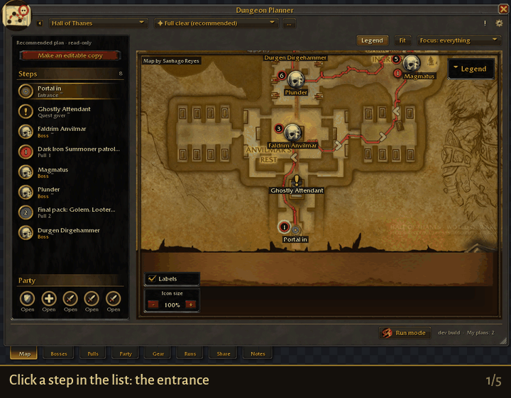
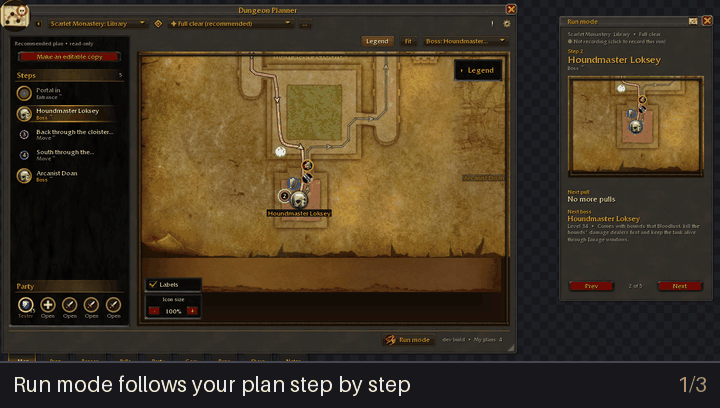
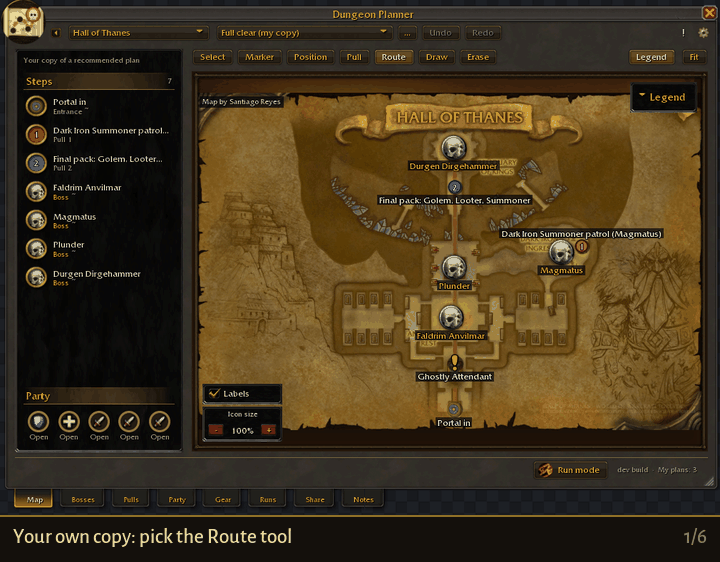
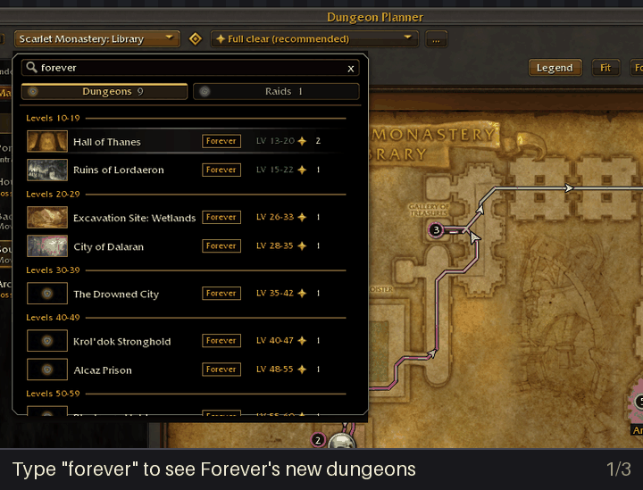

# Dungeon Planner (CurseForge description)

_The text below is the project description as published on CurseForge. Paste everything under the line._

---

# Dungeon Planner

**Plan your dungeon and raid runs in WoW: Forever, follow them step by step while you play, and share them with your group.**

**See it** (clips made from the addon's own UI; these links work once `docs/media/` is on `main`):

Dungeon Planner turns every dungeon and raid into a war table: the instance map fills the window, the plan's steps and your party sit beside it. Click a step and the map jumps to it: the right floor, that stretch of the route, the pull or boss, and where each role should stand.

**Works on its own:** maps, boss portraits, abilities, loot, levels and dungeon quests are built in. Other addons only add extras (see below).

> **Beta.** Everything works offline in tests, but the addon is new. Please report anything odd on GitHub and include the output of `/dp debug`.

## Features

*   **43 ready-made plans** for every classic dungeon and raid and all 9 new Forever dungeons: boss order, routes along the corridors, pulls, strategies and party positions. Make an editable copy to tweak one.
*   **A war table**: the map fills the window; the plan's steps (entrance, packs, bosses, objectives) and the party sit beside it, and clicking a step shows it on the map. Pick the instance and the plan from the header.
*   **Run mode**: a small window to keep open while playing: the current step, the next pull, the next boss's key abilities and a mini map, with Prev / Next (also on the pull key bindings) and automatic progress when a boss dies. With the run recorder on, it shows your progress against the plan and warns when you take more pulls than planned before a boss or kill bosses out of order.
*   **Run recorder** (opt-in): pulls, boss kills and wipes of your runs; a run against the plan (extra and skipped pulls, boss order), two runs side by side, splits against your best and previous run, a run summary for Discord.
*   **Maps**: the game's own dungeon maps for classic instances (multi-floor); for Forever's new dungeons, the hand-drawn maps by Santiago Reyes that come with the addon, used with his permission (or the game's own minimap pictures in the same parchment colours, if you prefer them).
*   **Map planning**: markers of 17 kinds (bosses, rares, packs, patrols, loot, chests, quest items and givers, NPCs, objects, entrances, exits, shortcuts, stairs, hazards, party positions, notes); raid marks; labels and notes per marker; drag to move; zoom and pan; layers you can hide; an Enemies layer showing where the plans' research placed creatures. Undo and redo (50 steps) for every change.
*   **Map drawing** on your own plans: pen, line, arrow, circle, box, text, eraser, eight colours and three widths; drawings can belong to a boss or a pull.
*   **Pulls**: ordered, coloured groups of markers with notes, tags (Interrupt, Crowd control, Line of sight, Pull with next, Skip, Careful), planned cooldowns and Bloodlust, and the forces after each pull; a Pull tool to click packs into pulls.
*   **Routes**: draw paths, build a route through your pulls, or let "Suggest order" find a short path.
*   **Bosses**: portrait, level, key abilities (names and tooltips from the game), loot and strategy for every boss of the recommended plans; your own bosses and phases with triggers.
*   **Assignments**: per boss and phase, for a player, a role, a raid group or everyone; raid groups 1-8; post them to group chat.
*   **Raid pages**: free-text assignment pages per boss with keywords (`{star}`, `{tank}`, `{group 2}`, `{mage}`), names in class colour; a small Notes window that opens on the boss's pull; the raid leader sends pages to the group.
*   **Gear**: each boss's drops plus your own recommendations per class, role, slot and boss (item IDs or dragged items, names from the game).
*   **Progress**: boss kills per run and lifetime (ENCOUNTER\_END, BOSS\_KILL, DBM/BigWigs as backup), an objective checklist per plan.
*   **Many plans per instance** (strategies, difficulties), profiles, a colour-blind setting.
*   **Sharing**: send to your group, guild or a player (accept/decline prompt, size and checksum checks); export and import strings; instance packs; Discord text split into 2000-character messages; a community plan repository; who in your group has the plan you sent, and whether their copy is outdated.
*   **English and Polish**, minimap button, key bindings, Addon Compartment, options in the game's Settings panel, a public API for other addons and WeakAuras.

## Optional companion addons

All optional. Dungeon Planner reads them in your game only (nothing is copied) and each can be switched off under Settings > Data from other addons; each source is named where its data shows.

*   **[Dungeon Journal](https://www.curseforge.com/wow/addons/dungeonjournal)**: extra boss details and boss pins on the maps of Forever's new dungeons, and a button to open it.
*   **[Forever Dungeon Routes](https://www.curseforge.com/wow/addons/forever-dungeon-routes)**: its routes as an extra map layer.
*   **[OpenMap](https://www.curseforge.com/wow/addons/openmap)**: another map source; your plans appear on its dungeon cards.
*   **[NeedRoll](https://www.curseforge.com/wow/addons/needroll)**: an "Open in NeedRoll" button in Gear.
*   **[Questie](https://www.curseforge.com/wow/addons/questie) / [QuestieDB](https://www.curseforge.com/wow/addons/questiedb)**: the dungeon's quests in Runs.
*   **[DBM](https://www.curseforge.com/wow/addons/deadly-boss-mods)** or **[BigWigs](https://www.curseforge.com/wow/addons/big-wigs)**: boss kills as a backup to the game's own events.
*   **[WoW Po Polsku Forever](https://www.curseforge.com/wow/addons/forever-wowpopolsku-2-0)**: switches the interface to Polish automatically.

## Good to know

*   WoW: Forever does not tell addons where you or any creature are inside an instance. Nothing is placed on the map automatically; the run recorder works from combat, nameplates and boss kills.
*   The Adventure Guide is disabled on Forever, so Dungeon Planner brings its own boss data and maps.
*   Your plans stay on your computer. Sharing sends only the plan you choose.

## Commands

`/dp` opens the planner · `/dp run` run mode · `/dp notes` the Notes window · `/dp settings` options · `/dp debug` a report of what your client supports (please include it in bug reports).

## Credits

*   **Forever dungeon maps by Santiago Reyes**, used with his permission. If you enjoy them, please support his work: [sreyesmaps.com/donaciones](https://sreyesmaps.com/donaciones).
*   Recommended routes from Forever Dungeon Routes by Checkov23 (MIT); boss positions and instance data from OpenMap (MIT); boss facts from Wowhead and warcraft.wiki.gg; strategies written in our own words from community guides.
*   Bundled font: Alegreya Sans (SIL Open Font License).

Full credits and licences, source code, issues and changelog: [github.com/xdk78/DungeonPlanner](https://github.com/xdk78/DungeonPlanner) (code under the MIT licence; the bundled maps keep their own terms).
